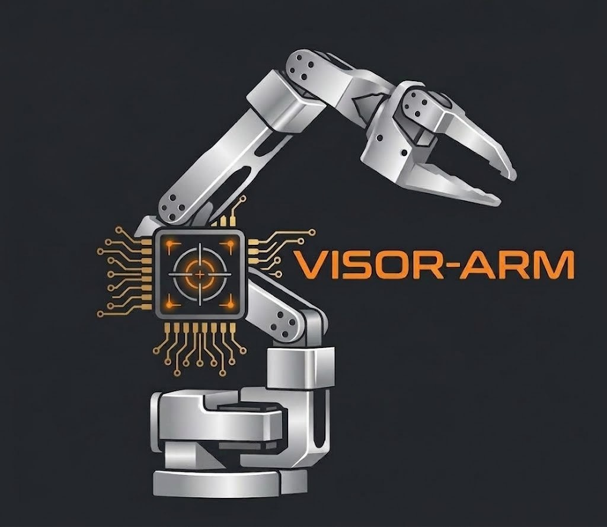
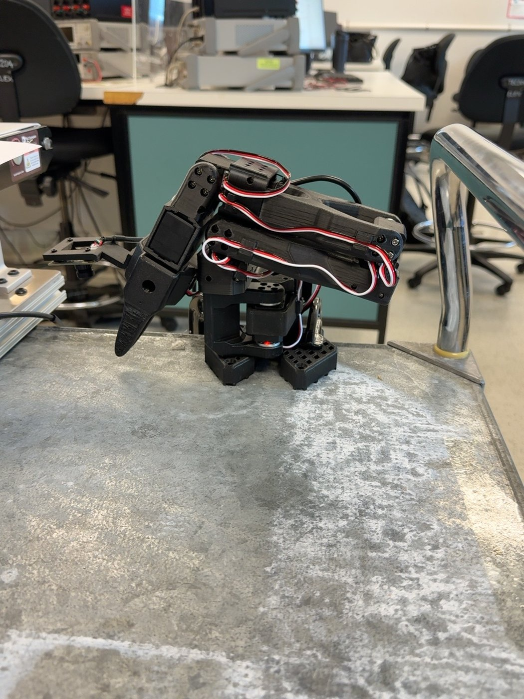
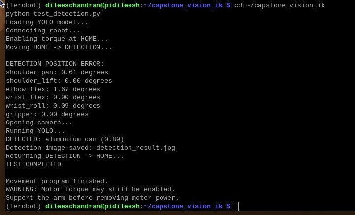
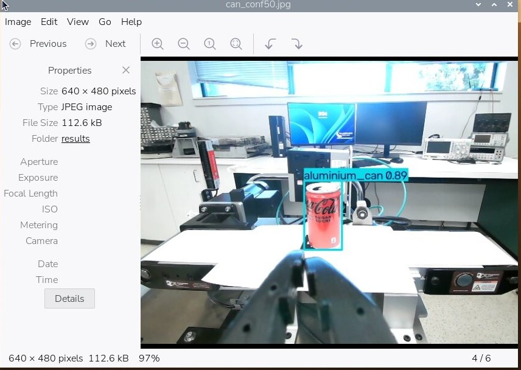
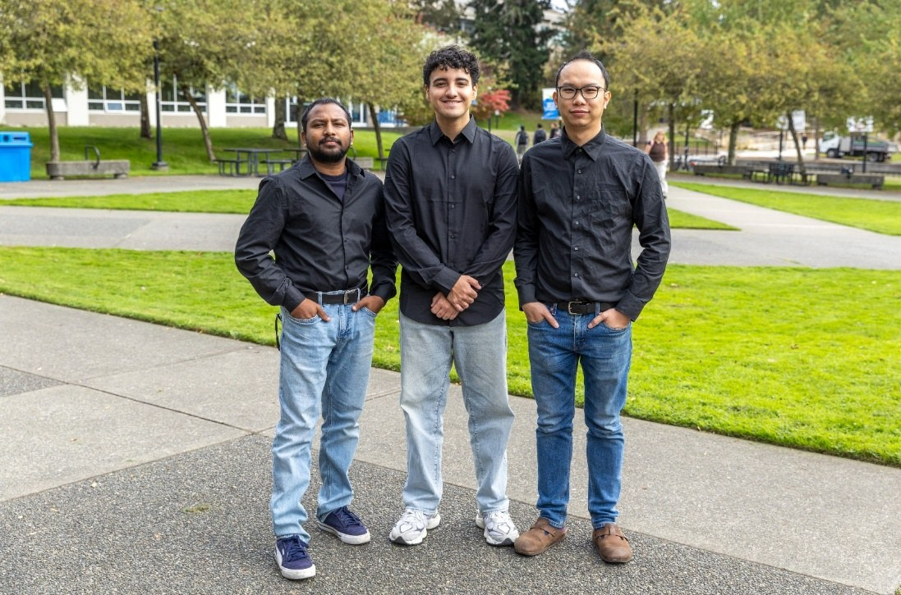

<p align="center"></p>

# VISOR Arm — AI-Powered Robotic Sorting System

**Capstone Project 2026 · Robotics · Computer Vision · Imitation Learning · Automated Sorting**

VISOR Arm automatically identifies and sorts **plastic bottles** and **aluminium cans** using an SO-101 robotic arm, a Raspberry Pi 5, YOLO object detection and an ACT (Action Chunking Transformer) imitation-learning policy. Integration with a PLC-controlled conveyor is being developed.

**Project status (November 2026):** The continuous sorting loop runs on the Raspberry Pi with the `VISOR_ACT_20000` ACT model. The gripper overload problem has been solved with a feedback guard, and the system was demonstrated on 13 Nov 2026. PS5-controller teleoperation is also working. Repeatable end-to-end performance figures (success rate, cycle time) haven't been measured yet.

---

<p align="center">
  
  
  
</p>

## Demo video

<p align="center">
  <a href="https://youtu.be/U8vxkrAfL1I">
    
  </a>
  <br><a href="https://youtu.be/U8vxkrAfL1I"><b>▶ Watch the demo on YouTube (0:40)</b></a>
</p>

## System overview

```
Camera ──► YOLO detection ──► bottle or can? ──► ACT pickup (with gripper guard)
                                                      │
       ◄── return to DETECTION ◄── release ◄── move to correct bin
```

`HOME → DETECTION → YOLO → ACT → CORRECT BIN → RELEASE → DETECTION → REPEAT`

A **normal stop** (Ctrl+C or the dashboard STOP button) finishes the current object and returns to HOME if there's no motor fault. It is **not** an emergency stop.

## Repository structure

```
VISOR-Arm/
├── yolo_detection/      # Stage 1: camera, YOLO, motor bus, saved poses, Flask dashboard
├── act_policy/          # Stage 2: ACT pickup + gripper overload guard
├── robot_control/       # Stage 3: continuous sorting controller
├── teleoperation/       # PS5 DualSense controller teleoperation + motor diagnostics
├── docs/                # Technical report, gripper overload write-up
├── mqtt_plc/            # MQTT / PLC conveyor integration (in progress)
├── fusion360_designs/   # CAD: curved gripper jaw, Pi 5 enclosure (to be added)
├── hardware/            # Hardware notes
├── images/              # Photos and demo media (to be added)
├── SETUP_GUIDE.md
├── SYSTEM_ARCHITECTURE.md
├── PROJECT_PROGRESS.md
└── requirements.txt
```

## Modules

| Module | What it does |
|---|---|
| [YOLO Object Detection](yolo_detection/) | Detects bottles and cans, confirms the object over 10 stable frames, and serves the dashboard |
| [ACT Imitation Learning](act_policy/) | Runs the learned pickup through LeRobot with the gripper overload guard |
| [Robot Control](robot_control/) | Continuous sorting loop combining saved poses and ACT, with safety checks |
| [PS5 Teleoperation](teleoperation/) | Drives the arm live with a PS5 DualSense controller |
| [MQTT and PLC Integration](mqtt_plc/) | Raspberry Pi ↔ Mosquitto ↔ CompactLogix 5380 conveyor link |
| [Fusion 360 Designs](fusion360_designs/) | Gripper modification and enclosure CAD |
| [Hardware](hardware/) | Components and connections |

## Documentation

| Document | Description |
|---|---|
| [Technical Report (PDF)](docs/VISOR_Arm_Technical_Documentation.pdf) | Project overview, development and testing |
| [Gripper Overload Fix](docs/GRIPPER_OVERLOAD_FIX.md) | How the gripper overload error was diagnosed and solved |
| [Setup Guide](SETUP_GUIDE.md) | Hardware and software configuration |
| [System Architecture](SYSTEM_ARCHITECTURE.md) | Components and workflow diagrams |
| [Project Progress](PROJECT_PROGRESS.md) | Completed work and next steps |

## Hardware

| Component | Role |
|---|---|
| SO-101 follower arm (Feetech STS3215 servos) | Picks up and places objects |
| SO-101 leader arm | Records ACT demonstrations; re-used as a follower for the PS5 teleop demo |
| Raspberry Pi 5 | Main computer: detection, ACT inference, control |
| USB cameras (640 × 480) | Object detection and ACT observations |
| PS5 DualSense controller | Teleoperation |
| Hailo-8L AI accelerator | Investigated for faster inference |
| Bottle and can bins | Sorting destinations |

## Software

Python · LeRobot 0.6.2 · Ultralytics YOLO11n · OpenCV · Flask · pygame (teleop) · Paho MQTT / pycomm3 (PLC work)

## Running the sorting system (Raspberry Pi)

The stage scripts import each other, so **all of them must be in one folder** on the Pi (`~/capstone_vision_ik`):

```bash
cd ~/capstone_vision_ik
export GRIPPER_GUARD=1
source gripper_settings.sh
ACT_SECONDS=60 ENABLE_BIN_MOTION=1 python3 visor_stage3_sort_v2.py
```
Then open `http://<pi-ip>:5000` for the dashboard. See [robot_control/](robot_control/) for all the options.

### Not included in this repository
- **Model weights:** `models/best.pt` (YOLO) and `VISOR_ACT_20000/pretrained_model` (ACT) are too large for Git.
- **Device-specific files:** LeRobot calibration JSON files and the saved poses in `calibration/*.json`.

## Key engineering challenges solved

- **Gripper overload:** ACT commanded the gripper tighter than the object, so the STS3215 tripped its overload protection. This was solved with a torque cap plus load and position feedback that holds the grip instead of squeezing harder. [Full write-up](docs/GRIPPER_OVERLOAD_FIX.md)
- **Weak leader-arm servos in teleop:** the P gain was raised on the joints that work against gravity. [Details](teleoperation/)
- **False starts from single-frame detections:** a 10-frame stability check was added before the robot reacts.

## Current limitations and next steps
- Improve aluminium can detection (the initial can mAP50 was only 4.9%).
- Record repeatable sorting results: success rate and cycle time.
- Reduce the delay between detection and the start of ACT, and smooth the moves between poses (see Issue #1).
- Confirm whether inference uses the Hailo-8L or the Pi CPU.
- Complete and document the PLC/MQTT conveyor integration.
- Add photos, demo video and CAD files.

## Team

<p align="center"></p>

| Member | Responsibilities |
|---|---|
| **Martin** | PLC automation (conveyor belt) · Documentation |
| **Dileesh** | SO-101 training (ACT) · Object detection integration |
| **Chan** | IoT design · Smart receptacles |

## Safety
Operate the robot in a clear workspace and supervise all automatic motion. The dashboard's normal stop is a software request, not a safety-rated emergency stop. Check the calibration and test poses at low speed before enabling `ENABLE_BIN_MOTION=1`.
