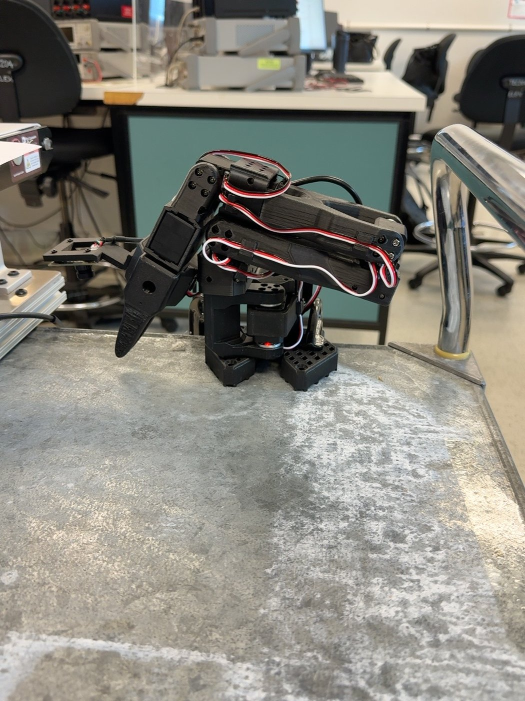
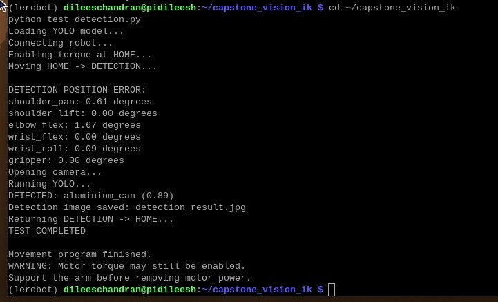
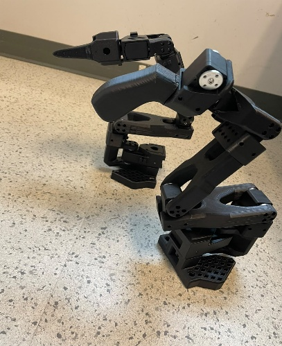
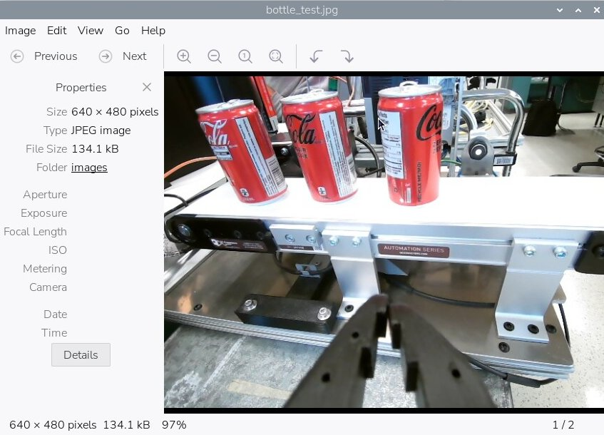
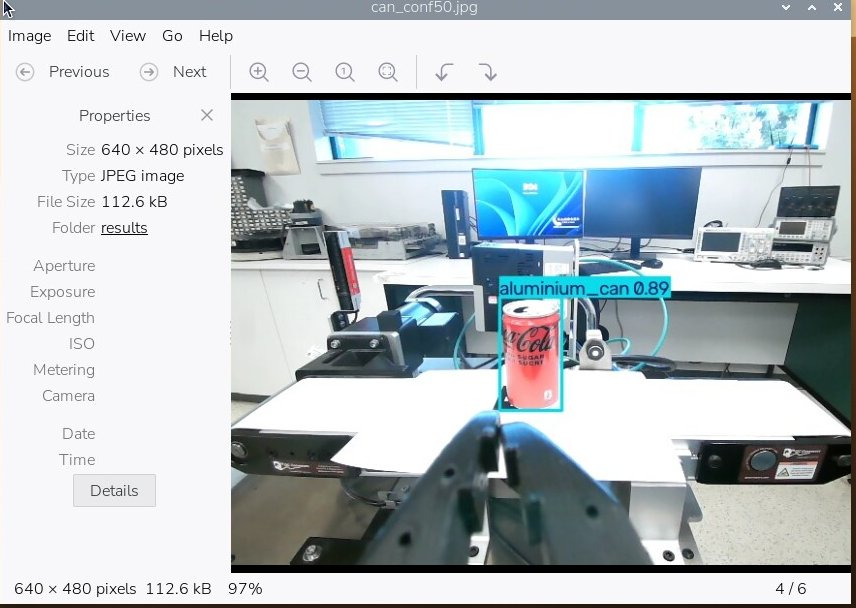
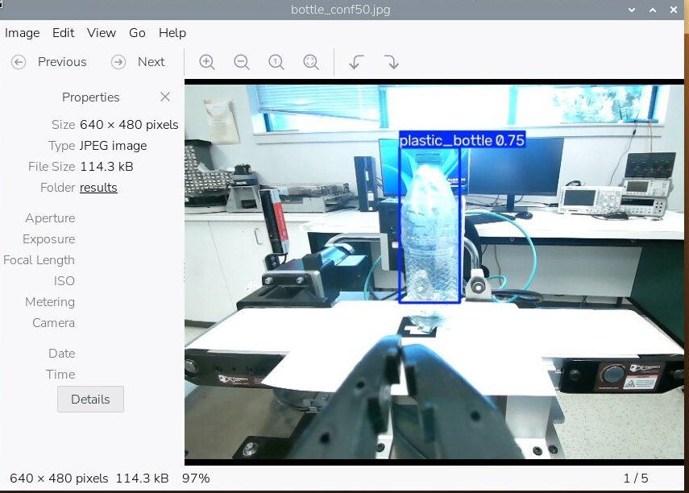
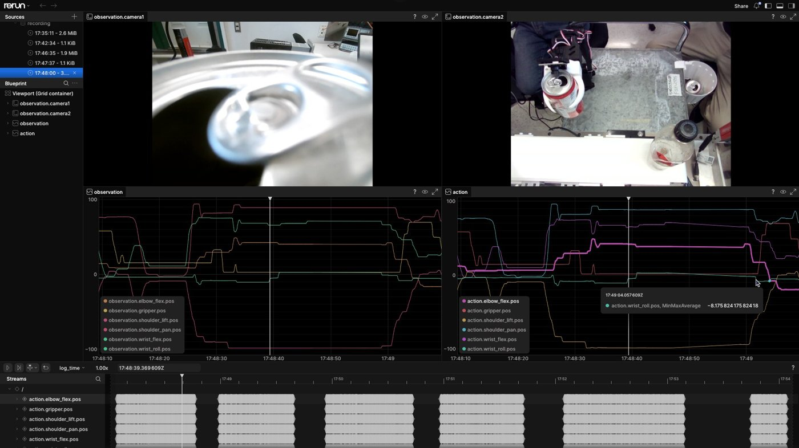

# VISOR Arm — Step-by-Step Setup Guide

This guide follows the order we actually built the working arm: assembling and calibrating the SO-101, setting up the camera and YOLO, recording the robot poses, ACT, the gripper guard, and finally running continuous sorting.

<p align="center">
  
  
</p>

---

## What you need

**Hardware**
- SO-101 follower arm and SO-101 leader arm (Feetech STS3215 servos)
- Raspberry Pi 5 running Raspberry Pi OS
- USB cameras at 640 × 480: one on the gripper and one top view
- Hailo-8L AI HAT (optional; see Step 4)
- Plastic bottles, aluminium cans and two bins
- PS5 DualSense controller (optional; for [teleoperation](teleoperation/))

**Connections we used**

| Device | Port |
|---|---|
| Follower arm | `/dev/ttyACM0` |
| Leader arm | `/dev/ttyACM1` |
| Gripper camera | `/dev/video0` |
| Top camera | `/dev/video2` |

> USB port and camera numbers can change after a reboot or after re-plugging. Always check them again (Step 3).

---

## Step 1 — Assemble and calibrate the SO-101



We built both arms following the official open-source guide:
**https://huggingface.co/docs/lerobot/so101**

That guide covers installing LeRobot, setting each motor's ID, assembly and calibration. We used **LeRobot 0.6.2** in a Python environment called `lerobot`.

The follower calibration file ends up here, and our scripts read it:
```
~/.cache/huggingface/lerobot/calibration/robots/so_follower/my_awesome_follower_arm.json
```

**Our change:** the moving gripper jaw and the wrist-roll part were replaced with our **curved gripper**, so the arm can hold round bottles and cans. See [fusion360_designs/](fusion360_designs/).

<br clear="right">

## Step 2 — Create the project folder and vision environment

```bash
/usr/bin/python3 -m venv vision_env
source vision_env/bin/activate

mkdir -p ~/capstone_vision_ik
cd ~/capstone_vision_ik

python -m pip install opencv-contrib-python numpy
```

Check that OpenCV is installed, including ArUco:
```bash
python -c "import cv2; print('OpenCV:', cv2.__version__); print('ArUco available:', hasattr(cv2, 'aruco'))"
```

## Step 3 — Find and test the camera

List the video devices:
```bash
ls -l /dev/video*
```
The Pi 5 shows many `/dev/video*` entries. Most of them belong to the Pi's own video-processing hardware, so find the actual USB camera with:
```bash
v4l2-ctl --list-devices
```

Take a test picture:
```bash
python - <<'PY'
import cv2
from pathlib import Path

camera = cv2.VideoCapture("/dev/video0", cv2.CAP_V4L2)
camera.set(cv2.CAP_PROP_FRAME_WIDTH, 640)
camera.set(cv2.CAP_PROP_FRAME_HEIGHT, 480)

if not camera.isOpened():
    print("ERROR: Camera could not open")
else:
    for _ in range(10):          # let auto-exposure settle
        camera.read()
    success, frame = camera.read()
    if success:
        output = Path.home() / "capstone_vision_ik/images/test.jpg"
        output.parent.mkdir(parents=True, exist_ok=True)
        cv2.imwrite(str(output), frame)
        print("SUCCESS: Camera working!")
        print("Image saved:", output)
        print("Resolution:", frame.shape)
    else:
        print("ERROR: Could not capture image")
camera.release()
PY

xdg-open ~/capstone_vision_ik/images/test.jpg
```



## Step 4 — (Optional) Check the Hailo-8L AI HAT

The Hailo-8L can make detection faster and take load off the Pi's CPU. We checked that it works, but **our bottle/can detector currently runs with Ultralytics on the CPU**.

```bash
# Is the Hailo chip detected?
hailortcli fw-control identify

# Does the system Python see the Hailo library?
/usr/bin/python3 -c "import hailo_platform; print('SUCCESS: System Hailo Python API works')"
/usr/bin/python3 -c "import hailo_platform; print(hailo_platform.__file__)"

# Make it visible inside vision_env permanently
echo "/usr/lib/python3/dist-packages" > \
  ~/capstone_vision_ik/vision_env/lib/python3.13/site-packages/hailo_system.pth
python -c "import hailo_platform; print('SUCCESS: Hailo AI HAT ready in vision_env')"

# List the Hailo models that are installed
find /usr/share/hailo-models /usr/local/hailo /opt/hailo -type f -name "*.hef" 2>/dev/null
```

A quick model-loading test (`~/capstone_vision_ik/scripts/hailo_detect.py`):
```python
from hailo_platform import HEF

MODEL_PATH = "/usr/share/hailo-models/yolov8s_h8l.hef"   # Hailo-8L YOLOv8
hef = HEF(MODEL_PATH)
inputs = hef.get_input_vstream_infos()
outputs = hef.get_output_vstream_infos()
print("Input:", inputs[0].name, inputs[0].shape)
print("Output:", outputs[0].name, outputs[0].shape)
```

## Step 5 — Train YOLO for bottles and cans

```bash
python -m pip install ultralytics
```

- **Dataset:** about 6,267 images of plastic bottles and aluminium cans, collected from **Roboflow Universe**.
- **Classes:** `plastic_bottle`, `aluminium_can`
- **Model:** YOLO11n, trained on a laptop with an RTX 3050.
- Copy the trained weights to the Pi as `~/capstone_vision_ik/models/best.pt`.

<p>
  
  
</p>

These test detections had a confidence of 0.75 for the bottle and 0.89 for the can. See [yolo_detection/](yolo_detection/) for the mAP results.

## Step 6 — Record the robot poses

Move the arm to each pose, then read the joint positions:
```bash
conda activate lerobot        # or: source <your lerobot env>/bin/activate
python robot_control/read_arm_position.py
```
Save each set of values in `~/capstone_vision_ik/calibration/`:

| File | Pose |
|---|---|
| `home_pose.json` | folded, safe resting pose |
| `detection_pose.json` | camera looking at the pickup area |
| `sorting_poses.json` | `pickup_open`, `pickup_closed`, `lift_closed`, `bottle_bin_closed`, `bottle_bin_open`, `can_bin_closed`, `can_bin_open` |
| `gripper_open.json`, `gripper_closed.json` | gripper open and closed values |

**Test it:** we ran HOME → DETECTION → YOLO → HOME first, to check the poses and the detection together before adding any pickup.



The position errors were all under 2°, and the can was detected and the arm returned home.

## Step 7 — Record demonstrations and train ACT

1. Record pickup demonstrations with the **leader arm** moving the **follower arm**, using both cameras (gripper and top view) and LeRobot's recording tools (see the [LeRobot SO-101 docs](https://huggingface.co/docs/lerobot/so101)).
2. Train an **ACT** policy on the dataset. Our final model is **`VISOR_ACT_20000`**.
3. Copy it to the Pi at `~/models/VISOR_ACT_20000/pretrained_model`.



## Step 8 — Turn on the gripper overload guard

On its own, ACT squeezed bottles and cans until the gripper servo tripped its overload protection. `act_policy/guarded_act_rollout.py` limits the torque and holds the grip once it detects contact. The full story is in [docs/GRIPPER_OVERLOAD_FIX.md](docs/GRIPPER_OVERLOAD_FIX.md).

```bash
export GRIPPER_GUARD=1
source gripper_settings.sh
python guarded_act_rollout.py --guard-check     # checks the settings without moving the arm
```

## Step 9 — Run continuous sorting

Put every stage script in `~/capstone_vision_ik`:
`stage1_detection.py`, `stage2_act.py`, `guarded_act_rollout.py`, `visor_stage3_sort_v2.py`, `auto_sort_sequence.py`, `gripper_settings.sh` and the `templates/` folder.

```bash
cd ~/capstone_vision_ik
export GRIPPER_GUARD=1
source gripper_settings.sh

# First test: one object only
SINGLE_CYCLE=1 ACT_SECONDS=60 ENABLE_BIN_MOTION=1 python3 visor_stage3_sort_v2.py

# Continuous sorting
OMP_NUM_THREADS=4 ACT_SECONDS=60 ENABLE_BIN_MOTION=1 python3 visor_stage3_sort_v2.py
```
`OMP_NUM_THREADS=4` lets PyTorch use all four Pi 5 cores.

Open the dashboard from any device on the same network: **`http://<pi-ip>:5000/stage3`**. It shows the live camera feed, the robot status and a **REQUEST NORMAL STOP** button.

The cycle is:
```
HOME → DETECTION → YOLO → ACT pickup → correct BIN → RELEASE → DETECTION → repeat
```
To stop, press Ctrl+C or the dashboard button. The arm finishes the current object and then returns HOME.

---

## Safety checklist

- [ ] Workspace is clear and someone is watching the arm
- [ ] Calibration was checked after any re-assembly
- [ ] New poses were tested slowly, with `ENABLE_BIN_MOTION=0` first
- [ ] `GRIPPER_GUARD=1` is set before any ACT run
- [ ] Remember that the dashboard stop is a **normal stop, not an emergency stop**. Keep the arm's power supply within reach.

## Troubleshooting

| Symptom | Fix |
|---|---|
| Camera won't open | Run `v4l2-ctl --list-devices` again; the number may have changed |
| `Could not connect on port /dev/ttyACM0` | Re-plug the arm, run `ls /dev/ttyACM*`, and check that the arm is powered |
| Gripper stops with an overload fault | Make sure `GRIPPER_GUARD=1` is set and `gripper_settings.sh` was sourced |
| Position mismatch error | The arm couldn't reach the pose (obstacle, or low torque). Check the path and the motors with `teleoperation/visor_motor_check.py` |
| Cans are detected less reliably than bottles | Known limitation of the current model; add more can training images |
