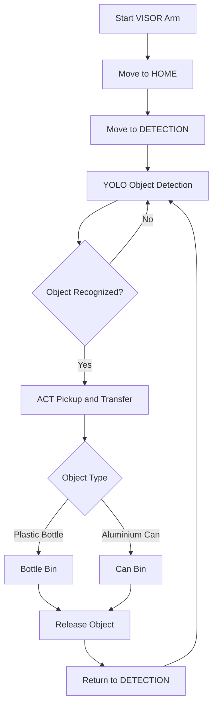
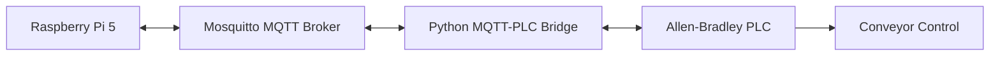

# VISOR Arm — System Architecture

## 1. System Overview

VISOR Arm is an AI-powered robotic sorting system developed to identify and separate plastic bottles and aluminium cans.

The system combines computer vision, imitation learning, robotic arm control, and industrial automation.

## 2. Main System Components

| Component | Function |
|---|---|
| Raspberry Pi 5 | Main computing platform |
| SO-101 Follower Arm | Object pickup and placement |
| SO-101 Leader Arm | Teleoperation and training demonstrations |
| USB Cameras | Object detection and ACT visual observations |
| YOLO | Bottle and aluminium can classification |
| ACT Policy | Learned robotic pickup and transfer movements |
| Python | System coordination and robot control |
| MQTT | Messaging for industrial communication |
| Allen-Bradley PLC | Conveyor automation integration |
| Ultrasonic Sensor | Detects objects at the conveyor stopping position |

## 3. Robot Sorting Architecture

## 4. Computer Vision

The Raspberry Pi 5 processes camera images using YOLO to identify plastic bottles and aluminium cans.

The recognized object class is passed to the robotic sorting controller.

## 5. Robotic Arm Control

The SO-101 robotic arm uses Feetech servo motors.

Python scripts manage:

- Saved joint positions
- HOME and DETECTION movements
- Motor position feedback
- ACT execution
- Sorting-bin movements
- Normal stopping and fault handling

## 6. ACT Imitation Learning

ACT (Action Chunking Transformer) learns robotic actions from demonstrations collected using the SO-101 leader and follower arms.

The trained policy is used to perform pickup and transfer movements.

## 7. MQTT and PLC Communication

MQTT and PLC integration is being developed to coordinate the robotic sorting system with conveyor automation.

The planned communication architecture is:

This represents the intended integration architecture, not a verified end-to-end communication result.

## 8. Normal Stop and Safety

The sorting controller includes a normal-stop request.

During normal operation, the controller is designed to complete the current operation and return the arm to HOME when no motor fault occurs.

If a motor or movement fault is detected, automatic motion is halted rather than assuming a safe return path.

The software normal-stop function is not an emergency-stop system.

## 9. Development Status

YOLO object detection, saved-position robotic control, and ACT-related development have been documented.

MQTT communication testing and PLC integration development are also underway.

Further verification is required to establish the reliability and performance of the complete automated sorting system.
