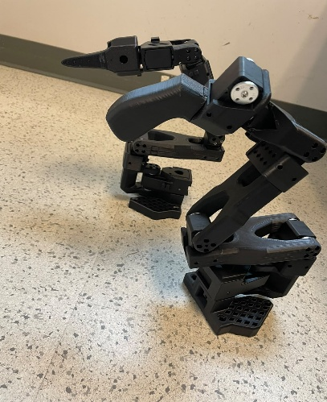
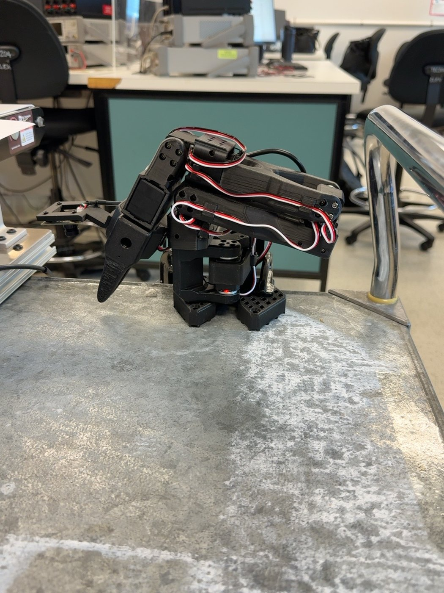
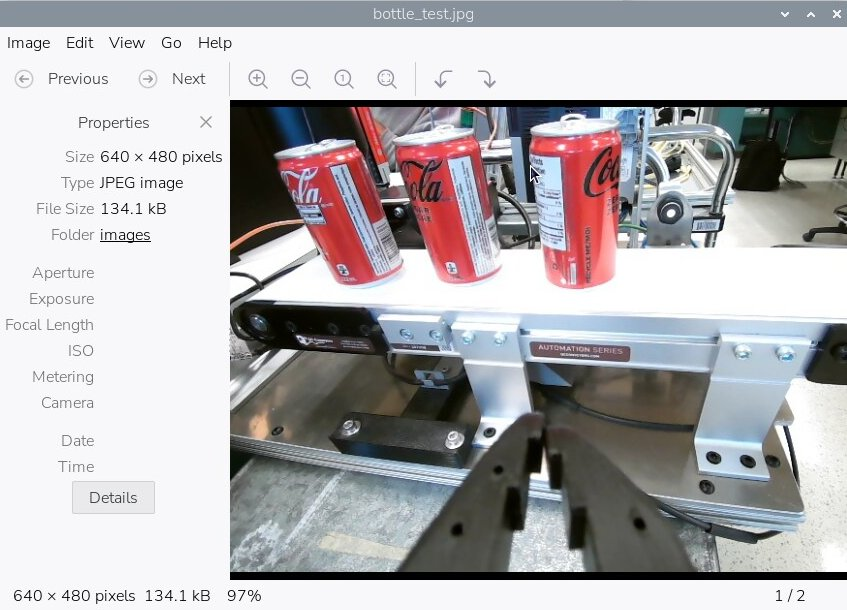
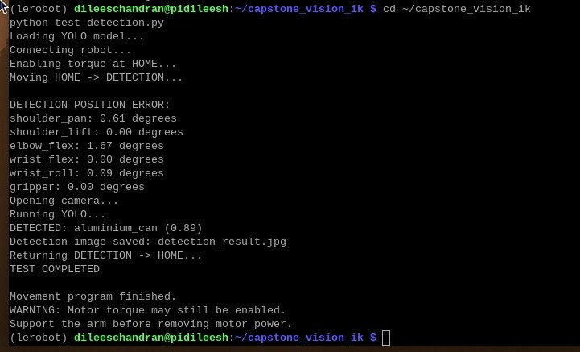
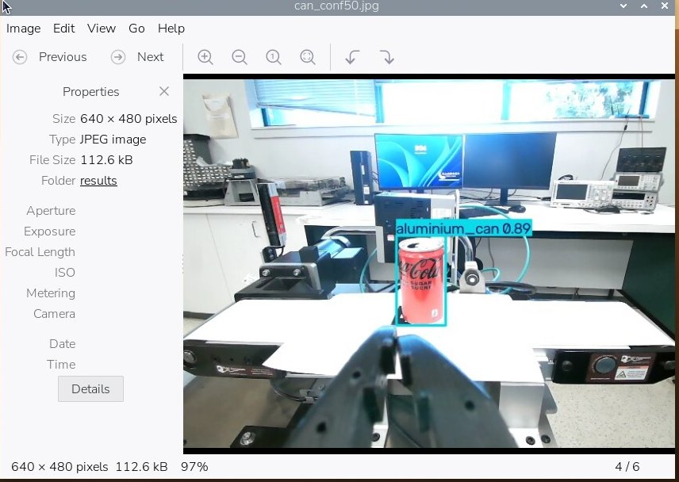
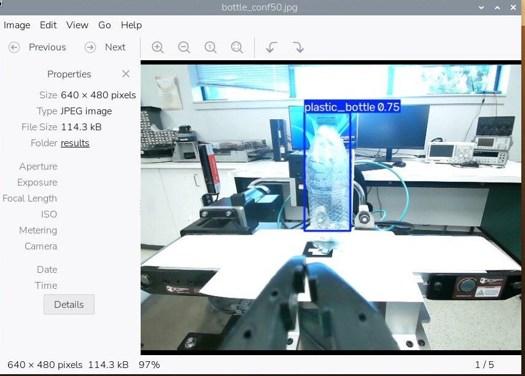
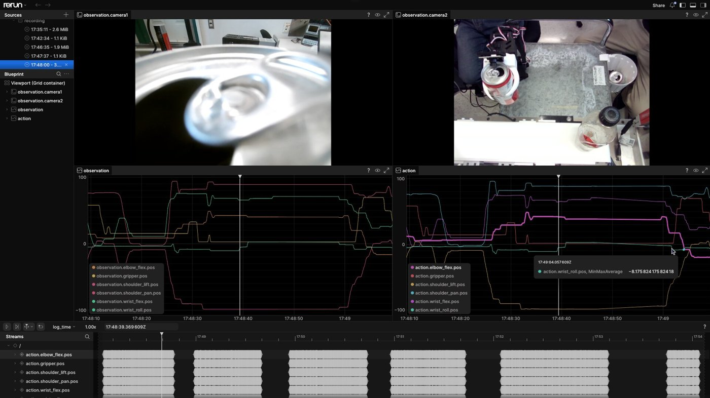

# VISOR Arm – Images

| Image | Shows |
|---|---|
|  `so101_arm_assembled.jpg` | Assembled SO-101 arm |
|  `so101_follower_on_bench.jpg` | Follower arm with the gripper camera, mounted at the conveyor |
|  `camera_test_image.jpg` | First test image from the gripper camera |
|  `yolo_detected_plastic_bottle.jpg` | YOLO detecting a plastic bottle (0.75) |
|  `yolo_detected_aluminium_can.jpg` | YOLO detecting an aluminium can (0.89) |
|  `detection_test_terminal.jpg` | HOME → DETECTION → YOLO → HOME test run |
|  `act_dataset_rerun_view.jpg` | Recorded ACT episode viewed in Rerun (both cameras plus joint data) |
